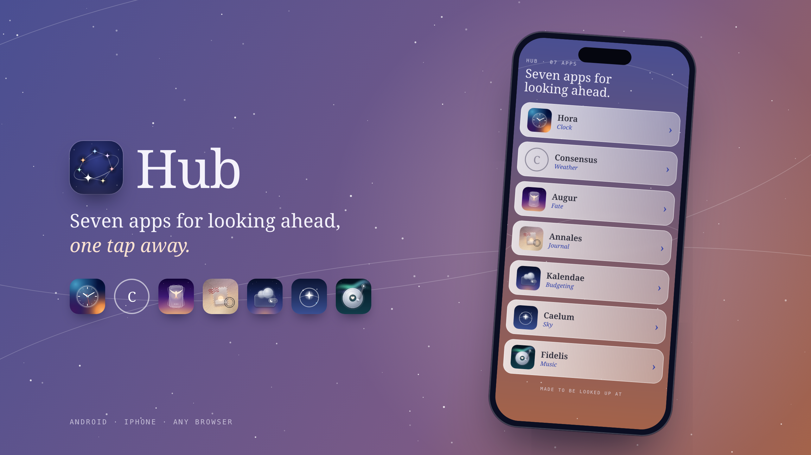

# Hub

<b>Seven apps for looking ahead, one tap away.</b>

 

No app store, no account, no ads. Get the **Android app**, or keep Hub on any phone's Home Screen. Nothing is collected.

---

☕️ You can support me and Buy me a coffee ☕️

https://buycoffee.to/szebastian

---

## What's inside

- **🕰 [Hora](https://github.com/Szebastian31/hora):** a clock, alarm, timer and stopwatch that tells you how right it is.
- **🌦 [Consensus Weather](https://github.com/Szebastian31/Consensus_Weather):** thirteen weather models, and where they agree.
- **✦ [Augur](https://github.com/Szebastian31/augur):** your stars, six ways, and where they agree.
- **📮 [Annales](https://github.com/Szebastian31/annales):** your days, sealed as stamps.
- **🌙 [Kalendae](https://github.com/Szebastian31/kalendae):** a forecast for your money, and what's safe to spend until payday.
- **🔭 [Caelum](https://github.com/Szebastian31/caelum):** hold your phone up and the real sky lines up behind the glass.
- **🎧 [Fidelis](https://github.com/Szebastian31/fidelis):** a faithful companion for your Spotify: mood mixes, podcasts, lyrics and radio from around the globe.

Every app has an Android app and a web version for iPhone and any browser. Tap a row and the app opens. In the Android app, an app that isn't installed has a faded row and opens its web version instead.

## Getting started

### Android app (recommended)

1. Open **[Releases](https://github.com/Szebastian31/hub/releases/latest)** on your phone and download **Hub_v….apk**.
2. Open the file. If Android asks, allow your browser to **install unknown apps**.
3. Open Hub and tap any app.

Updating: download the new APK and install it over the old one.

### iPhone or any browser

1. Open **[szebastian31.github.io/hub](https://szebastian31.github.io/hub/)**.
2. **iPhone (Safari):** tap **Share**, then **Add to Home Screen**. **Android (Chrome):** tap **⋮**, then **Install app**.

Each row opens that app's web version. Add the ones you use to your Home Screen too, so they open full screen.

## Privacy

Hub keeps nothing and sends nothing. The Android app only checks which of the seven apps are installed; the web version is a list of links.

## Questions or ideas?

Found a bug? [Open an issue](https://github.com/Szebastian31/hub/issues) and describe what happened, which phone you use and which browser.

## License

Released under the [MIT License](LICENSE).

---

_Hub is the front door to the family: Hora, Consensus Weather, Augur, Annales, Kalendae, Caelum and Fidelis, all signed with the same key and made to be looked up at._

For developers

The Android app is a single native Activity with no WebView and no libraries; its rows are built in code in `MainActivity.java`. The web version (`docs/`) is one plain HTML file that draws the same screen, hosted on GitHub Pages. GitHub Actions builds the APK on every push and publishes it as a release.

| Where | What it is |
| --- | --- |
| `app/src/main/java/com/szebastian/hub/MainActivity.java` | The list screen. The `APPS` list at the top holds each app's package name, name, category and web address |
| `app/src/main/AndroidManifest.xml` | The `<queries>` list, which Android 11+ needs before one app can see and open another |
| `app/src/main/res/` | Theme colours and the launcher icon |
| `app/src/main/assets/fonts/` | Noto Serif, bundled so the phone's theme font can't replace it |
| `docs/index.html` | The web version: the same sky, rows and fonts. Its own `APPS` list holds each app's name, category, web address and icon |
| `docs/icon.svg`, `docs/icons/` | Hub's icon (the launcher icon as SVG, plus PNGs made from it) and each app's icon |
| `docs/manifest.webmanifest`, `docs/sw.js` | Home-screen install and offline cache |
| `tools/icons.sh` | Copies each app's icon into `docs/icons/` from the app repos next to this one |
| `tools/screenshots.sh` | Makes `screenshots/banner.png` from the real web version, and the PNG icons |
| `.github/workflows/build.yml` | Builds the APK and publishes it as a release |

**Signing.** Builds are signed with the family key. It never lives in git: GitHub builds read it from the `FAMILY_*` secrets, local builds from `~/.gradle/gradle.properties`. Every build installs over the last one.

**Adding an app:** add a line to `APPS` in `MainActivity.java`, a `<package>` line to `<queries>` in `AndroidManifest.xml`, and a line to `APPS` in `docs/index.html` (and to `tools/icons.sh` for its icon). Then bump `versionName` + `versionCode` in `app/build.gradle` for a new APK release, and `VERSION` in `docs/sw.js` so installed web copies update.

**Screenshots:** `tools/icons.sh`, then `tools/screenshots.sh`. It needs Google Chrome and touches none of your own data.

